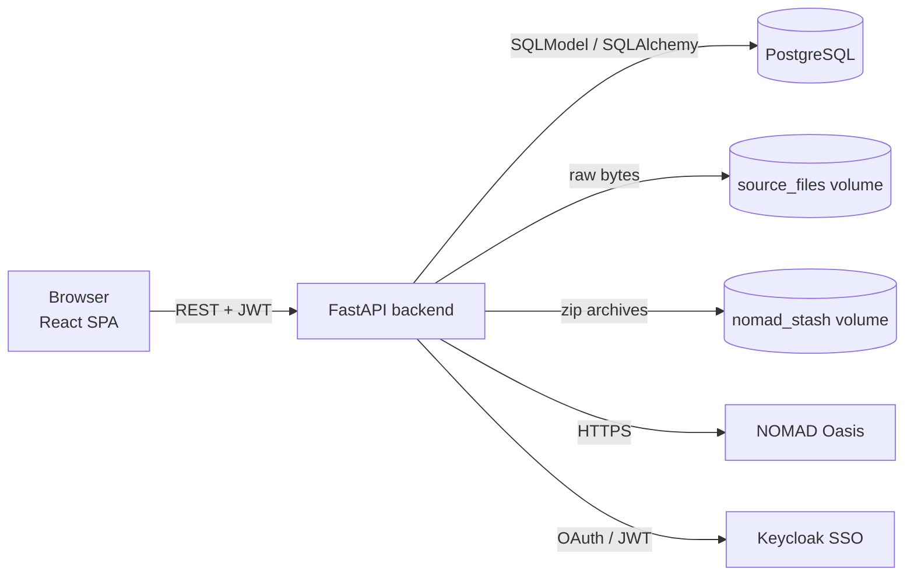
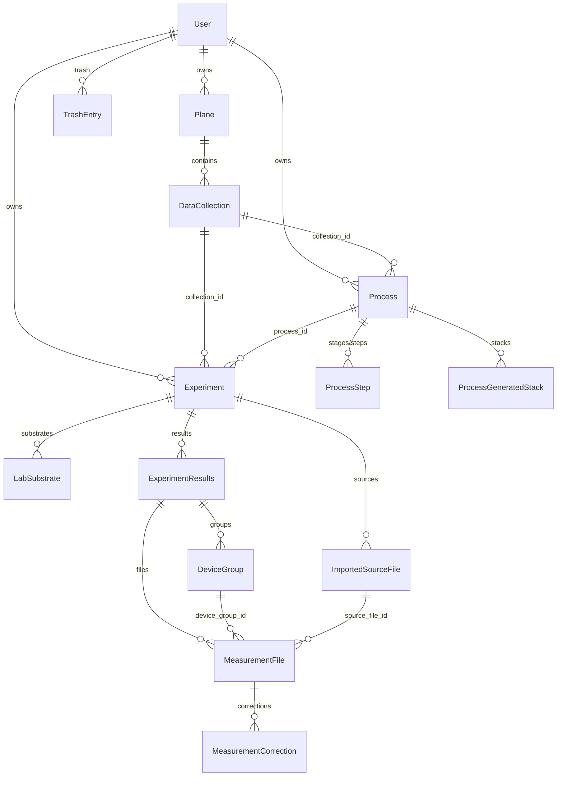

# Architecture

This document describes the system architecture, repository layout, entry points and the
scientific data model of Plains. It documents the implementation as it exists, not intended or
hypothetical behavior.

## System overview

Plains is a single-page React frontend backed by a FastAPI service, a PostgreSQL database and
two filesystem-backed stores. NOMAD is an external, optional target for data deposition.



- **Frontend** (`frontend/`): React + TypeScript + Vite, TanStack Router, Mantine (scientific
  GUI) and shadcn/ui + Tailwind (auth/admin). State lives in a central `AppContext`; all
  persistence goes through a `BackendAdapter` interface (`HttpBackend` in production,
  `InMemoryBackend` for tests). The API client under `frontend/src/client/` is generated from
  the backend OpenAPI schema — do not edit it by hand.
- **Backend** (`backend/`): FastAPI + SQLModel. One router per domain under
  `backend/app/api/routes/`. Business logic for NOMAD, import, trash and source storage lives
  in `backend/app/services/`.
- **PostgreSQL**: the single relational store. All primary keys are UUIDs; entity tables carry
  a `frontend_data` JSONB column for flexible UI state. The schema is created by `init_db()` at
  startup (see "Schema management" below), not by Alembic.
- **Source storage** (`source_files` volume): original imported measurement bytes, addressed
  by internal UUID. See `backend/app/services/source_store.py`.
- **NOMAD stash** (`nomad_stash` volume): temporary upload archives and failed-upload archives.
- **Authentication**: Keycloak SSO (via `keycloak-js`) or local JWT login; NOMAD OAuth can be
  enabled for uploads.

## Repository structure

```
backend/
  app/
    main.py                 FastAPI app setup (CORS, exception handlers, security headers)
    core/                   config, db (init_db), security (JWT/password), limiter
    models.py               all SQLModel tables + Pydantic schemas (one file)
    crud.py                 database helpers
    api/main.py             router registration
    api/routes/             one module per domain
    api/deps.py             session + current-user dependencies
    services/               nomad, zip_import, source_store, trash, chemicals_materialization
    nomad/data_schemas/     reference NOMAD archive YAML/JSON schemas
frontend/
  src/
    main.tsx                app bootstrap (theme, router, stale-chunk reload guard)
    routes/                 file-based TanStack Router pages (_gui/*.tsx = scientific GUI)
    store/AppContext.tsx    central snapshot + mutations (BackendAdapter)
    store/backend.ts        HttpBackend / InMemoryBackend + save/reconcile
    store/backendMapping.ts frontend <-> API payload mapping
    lib/                    pure domain logic (analysis, processingTimes, uploadFlow, …)
    client/                 generated OpenAPI client (do not edit)
docs/                       the documentation you are reading
scripts/                    dev/test/db-backup/db-restore/generate-client scripts
```

### Entry points

- **Backend**: `backend/app/main.py` builds the `FastAPI` app; `backend/app/api/main.py`
  registers the routers; `backend/app/initial_data.py` (run by `scripts/prestart.sh` at
  container start) calls `init_db()` to create/update the schema and seed the first superuser.
- **Frontend**: `frontend/src/main.tsx` is the React entry; routes are generated into
  `frontend/src/routeTree.gen.ts` (`bun run generate-routes`).

### Schema management

The schema is created by `init_db()` in `backend/app/core/db.py`, which calls
`SQLModel.metadata.create_all` (creates missing tables, never alters existing ones) followed by
a small set of ad-hoc `ALTER TABLE … ADD COLUMN IF NOT EXISTS` statements for columns added
after the first release. `backend/app/alembic/` holds a migration history that is **not** run
automatically and is already divergent from the models — do not run `alembic upgrade head`
against a deployment without reconciling it with `init_db` first.

## Data model

All entities use UUID primary keys and cascade deletes. Every entity has `Base`, `Create`,
`Update`, `Public` and `table=True` variants in `models.py`.



Key entities:

- **Plane / DataCollection / canvas notes** — the Organization canvas. `DataCollection`
  groups placed entities; sticky notes and text fields are separate canvas-element tables.
- **Process** — a fabrication recipe: inline substrates, solution recipes (solvents, solutes,
  added solutions), `ProcessStep` rows (grouped into stages by `stage_index`, alternatives by
  `step_index`), and `ProcessGeneratedStack` layers.
- **Experiment** — one run of a process (or a process-free imported dataset). Holds substrates
  (`LabSubstrate`), derived `date`/`end_date` (from the Processing table's step times),
  `chemicals_prep` and `processing_times` JSONB, and `has_results`/`has_completed_upload`
  flags. A process-free experiment has `process_id = NULL`.
- **ExperimentResults** — measurement results linked to an experiment; carries
  `nomad_upload_id`/`nomad_upload_status`/`nomad_upload_time` after a NOMAD upload.
- **MeasurementFile** — one measurement record (a JV scan direction, a summary row, etc.):
  device/cell/pixel identity, scalar JV metrics (`value`=PCE, `voc`, `jsc`, `ff`, `vmpp`,
  `jmpp`, `pmpp`, `rs`, `rsh`), the raw `curve` points, `direction` (FW/RV), `source_file_id`
  and `source_record_locator` provenance, `corrected_fields`, and `excluded`.
- **DeviceGroup** — persistent group membership for measurement files, with an
  `assigned_substrate_id` linking a group to a substrate.
- **ImportedSourceFile** — durable provenance for one original file: relative path, basename,
  size, SHA-256, and file type. The bytes live in the source store under the row's UUID.
- **MeasurementCorrection** — append-only correction history (field, operation, previous/new
  value, reason, actor, request id for idempotency).
- **TrashEntry** — one row per soft-deleted entity id, with the original plane/collection and
  the deletion root it belongs to.
- **LabMaterial / LabSolution** — inventory tables populated at NOMAD export time from an
  experiment's `chemicals_prep` data (not GUI CRUD entities).
- **Analysis** — registry for saved analyses (referencing processes/experiments/results via
  `AnalysisRef`); the UI keeps it disabled for now.
- **UserState** — per-user UI preferences as JSONB.

## Key code paths

The following traces the main persistence round-trip and are the places to start reading:

1. **Load**: `HttpBackend.load()` → `GET /state/bulk` → `backendMapping.bulkToSnapshot()`
   reconstructs the rich frontend shapes (including `DataCollection` membership from
   `collection_id` FKs) → `AppContext` state.
2. **Save**: `AppContext` debounces mutations and calls `HttpBackend.save()` →
   `syncToBackend()` upserts each domain and diff-deletes removed entities (results are never
   diff-deleted — they are removed only by explicit trash/delete).
3. **Import**: `POST /zip-explorer/import` (see `api/routes/zip_explorer.py`) persists original
   source bytes and returns structured measurements; the frontend then creates
   `ExperimentResults`, `DeviceGroup` and `MeasurementFile` rows.
4. **NOMAD**: `services/nomad.py` builds the archive and metadata; `api/routes/nomad.py`
   exposes the upload endpoints. See [NOMAD.md](NOMAD.md).

## Authentication, ownership, sharing and trash

- **Authentication.** Two paths coexist: Keycloak SSO (a `keycloak-js` singleton in
  `frontend/src/lib/keycloakInstance.ts`) and local JWT login (`lib/auth.ts`). The `_gui` route
  layout enforces authentication via `beforeLoad: ensureAuthenticated`. NOMAD OAuth can be
  enabled separately for uploads (`NOMAD_OAUTH_ENABLED`), which links a user's `nomad_sub`.
- **Ownership.** Every entity carries `owner_id`; the `visible()` query helper and
  `_verify_owner`/`_owned_*` route helpers scope reads and writes to the caller (superusers
  bypass). Cross-user access to an experiment, result or collection returns 403.
- **Sharing.** A plane can be shared with other users via `PlaneShare` rows (`plane_id` →
  `user_id`); shared planes appear in the Organization canvas for those users.
- **Trash / restore.** Deletion is soft: `services/trash.py` `soft_delete` writes a
  `TrashEntry` and cascades **down** (process → experiments → results; plane → its collections
  and members). `restore` re-attaches the whole deletion batch **up** and decides placement
  server-side (original collection if alive, else a `Restored: …` collection, else a
  destination plane the client prompts for). Results that hold a completed NOMAD upload are
  never trashed. Trashed items are permanently swept after `TRASH_TTL_DAYS` (default 30 days).
  See the trash round-trip tests and `docs/plans/trash-restore-fix.md`.
